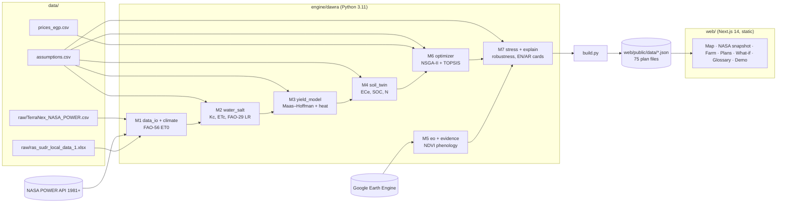

# Dawra AI — دورة

**Smarter 3-year crop rotations for salty, hyper-arid farms, powered by NASA data.**
NASA Space Apps Cairo 2026 · Challenge *Field Shift: Adapting Farms with NASA Data* · Team TerraNex · Pilot: Ras Sudr, South Sinai, Egypt.

> Decision support only — confirm with your local agricultural extension officer.

## The problem

Ras Sudr farms irrigate from wells at 6–9 dS/m (some > 20) in a place where the air demands **≈1,900 mm** of water a year
and it rains **≈47 mm**. The aquifer is getting saltier: the "highly saline" share of its area rose from **52 % (1996)
to 83 % (2022)** (S16). The typical farm grows barley in winter and leaves the land bare and hot in summer. Farmers have
no easy way to see which rotation saves water, keeps salt out of the root zone and still pays — or how a plan
would hold up in a hotter year or with a saltier well.

## The solution

For one farm (F001, 5 feddan, well 8.35 dS/m, 60 m³/day, drip), Dawra AI:

1. **Simulates the farmer's current rotation** (barley / fallow × 3) with the same model as every alternative.
2. **Optimises 6-season rotations** (NSGA-II, 21 local crops) for output, water and soil, and picks
   *highest output · water saver · soil builder* plus a **TOPSIS compromise for the farmer's own priorities**.
3. **Stress-tests every plan** on 45 years of NASA POWER climate (block bootstrap), +1/+2 °C, −10/−20 % rain and a
   well 1–2 dS/m saltier, with the well's m³/day cap.
4. **Explains every plan** in English and Arabic: *why · evidence (NASA data) · benefits · information gaps · risks for
   the extension officer*, all built from the computed numbers (no free-text generation).
5. Serves it as a **fast, bilingual (RTL) web app** with a map, NASA snapshot charts, plan cards, a what-if slider panel
   and a 30-second guided demo.

Every number traces to `data/raw`, a cited source (S1–S18, FAO-56, FAO-29, FAO-33) or a row of
[`data/assumptions.csv`](data/assumptions.csv) (129 documented assumptions). Decisions are logged in
[DECISIONS.md](DECISIONS.md); progress in [PROGRESS.md](PROGRESS.md).

## Results for F001 (well 8.35 dS/m, 60 m³/day)

See [reports/05_optimizer.md](reports/05_optimizer.md), [reports/06_stress.md](reports/06_stress.md) and
[reports/validation.md](reports/validation.md). Prices are not in the data yet, so plans are ranked by an **output
index** (share of the farm's potential harvest), flagged `prices_pending` everywhere.

| Plan | 6 seasons (W1 → S3) | Water, 3 yrs (m³) | Output index | Soil score | ECe end (dS/m) | Robust |
|---|---|---|---|---|---|---|
| Current rotation | barley → fallow → barley → fallow → barley → fallow | 15,260 | 1.45 | 52 | 7.58 | 96 % |
| Highest output | barley → sorghum → quinoa → sorghum → quinoa → sorghum | 31,256 (+105 %) | 2.01 (+39 %) | 61 | 5.93 | 100 % |
| Water saver | squash → fallow → squash → fallow → forage barley → fallow | 11,138 (−27 %) | 1.16 (−20 %) | 59 | 6.46 | 100 % |
| Soil builder | faba bean → sorghum → faba bean → sorghum → faba bean → cowpea | 32,409 (+112 %) | 1.21 (−17 %) | 72 | 5.43 | 100 % |
| Best balance — *balanced* profile | barley → fallow → forage barley → fallow → forage barley → fallow | 13,655 (−10.5 %) | 1.39 (−4 %) | 55 | 7.01 | 100 % |
| Best balance — *this farmer* profile | barley → fallow → barley → fallow → forage barley → fallow | 14,457 (−5 %) | 1.42 (−2 %) | 54 | 7.26 | 99 % |

Reading: with only 60 m³/day the well waters ≈2.4 of 5 feddan of barley and ≈1 feddan of a summer crop, so
"more output" means more water. Swapping some barley for forage barley (shorter season, less water) saves 5–27 % water
for a small output loss; legume rotations build nitrogen and cut salt the most but need double the water.

## NASA data used

| Data | Use in Dawra | Status |
|---|---|---|
| [NASA POWER](https://power.larc.nasa.gov/) daily (CERES SYN1deg radiation; MERRA-2 T2M min/max, RH2M, WS2M, PRECTOTCORR, GWETROOT), 1981–2026 | FAO-56 ET0, effective rain, heat days, soil-wetness context, every stress scenario | ✅ used |
| [Sentinel-2](https://developers.google.com/earth-engine/datasets/catalog/COPERNICUS_S2_SR_HARMONIZED) / [Landsat C2 L2](https://developers.google.com/earth-engine/datasets/catalog/landsat) NDVI | field history, bare seasons, vegetated-area check (1,579 ha, S16) | ⏳ code ready |
| [SMAP L4](https://developers.google.com/earth-engine/datasets/catalog/NASA_SMAP_SPL4SMGP_008) soil moisture | drought anomalies | ⏳ code ready |
| [GPM IMERG V07](https://developers.google.com/earth-engine/datasets/catalog/NASA_GPM_L3_IMERG_V07) | heavy-rain days | ⏳ code ready |
| [MODIS MOD11A2 / MOD16A2GF](https://developers.google.com/earth-engine/datasets/catalog/MODIS_061_MOD16A2GF) | LST anomalies, ET0 cross-check | ⏳ code ready |
| [SRTM 30 m](https://developers.google.com/earth-engine/datasets/catalog/USGS_SRTMGL1_003) | slope of fields | ⏳ code ready |
| [GRACE/GRACE-FO mascons](https://developers.google.com/earth-engine/datasets/catalog/NASA_GRACE_MASS_GRIDS_V04_MASCON_CRI) | regional groundwater trend | ⏳ code ready |
| [NEX-GDDP-CMIP6](https://developers.google.com/earth-engine/datasets/catalog/NASA_GDDP-CMIP6) | 2041–2060 climate deltas as a stress family | ⏳ code ready |

Earth Engine layers need a one-time login (see *Finish the Earth-observation layers* below); until then the app marks
them *pending* and uses POWER GWETROOT as the soil-moisture context.

## Architecture



No Python runs at request time: `engine/build.py` precomputes 5 priority profiles × 5 well ECw × 3 water supplies
(75 files, each with the current rotation, 4 plans, robustness, cards and a 7 × 4 × 4 what-if grid), so the app is a
static Next.js site that deploys to Vercel as-is.

## How to run

Requirements: Python 3.11 (`uv` recommended), Node 20+.

```bash
# 1) engine
uv venv --python 3.11 .venv
uv pip install --python .venv -r engine/requirements.txt
make test          # or: python tasks.py test   (Windows without make)
make data          # NASA POWER 1981+ (+ Earth Engine if authenticated) and reports 01/02/04
make build         # optimise + stress-test + export JSON to web/public/data (~3 min, 6 cores)

# 2) web
cd web && npm install && npm run dev      # http://localhost:3000   (?lang=ar for Arabic)
npm run build                             # production build
```

Other reports: `python -m dawra.agronomy_report`, `python -m dawra.sensitivity`, `python -m dawra.validation`
(run inside `engine/`).

### Finish the Earth-observation layers

```bash
earthengine authenticate
# PowerShell:  $env:GEE_PROJECT = "your-cloud-project"     bash:  export GEE_PROJECT=your-cloud-project
make data && make build
```

### Deploy (Vercel)

The Vercel project root is **`web/`** (`web/vercel.json`). Either deploy from that folder
(`cd web && npx vercel --prod`) or set *Root Directory = web* in the Vercel project settings.

## Limits (read before using)

- **Prices pending** — plans are ranked by output index, not money, until `data/prices_egp.csv` is filled.
- **One farm, station-level data.** Field-level NDVI history and SMAP/IMERG/MODIS/GRACE/CMIP6 need Earth Engine.
- **Robustness is high (≥ 95 %) for all plans** because the model assumes the full FAO-29 leaching water is applied;
  cards state the yield if it is not. Salt rise in unirrigated summer fallow, residue carbon and legume N are
  literature assumptions (see sensitivity report).
- **Wheat holdout is ambiguous** (S6 does not state the area unit): −15 % per feddan, +102 % per hectare.
- The model never replaces the farmer's or the extension officer's judgment.

## Repository map

`engine/dawra/` modules M1–M7 · `engine/tests/` (pytest) · `engine/build.py` · `data/` inputs, assumptions,
processed caches · `reports/` 01–08 + validation · `web/` Next.js app · `submission/` slides + video script.

Sources S1–S18 are listed in the Excel `Sources` sheet and on the app's *NASA data used* page.
