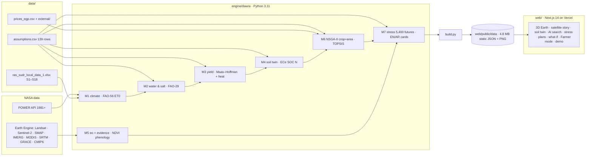

# Dawra AI — دورة

**From space to the field: smarter 3-year crop rotations for salty, hyper-arid farms, powered by NASA data.**
NASA Space Apps Cairo 2026 · Challenge *Field Shift: Adapting Farms with NASA Data* · **Team TerraNex**
Live: **https://dawra-ai.vercel.app** · Farmer mode: https://dawra-ai.vercel.app/farmer · NASA data: https://dawra-ai.vercel.app/nasa-data

> Decision support only — confirm with your local agricultural extension officer.

## The problem

In Ras Sudr (South Sinai, Egypt) crops need **≈1,912 mm** of water a year (FAO-56 from NASA POWER) and it rains
**≈47 mm** — rain covers **2.4 %** of the need. Farms pump wells at 6–9 dS/m (some > 20), and the aquifer is getting
saltier: the "highly saline" share of its area rose from **52 % (1996) to 83 % (2022)** (S16). Landsat shows the green
area of the plain growing from ~50 ha (1996) to ~1,200–1,600 ha (2022), so more farms now share that water. The typical
farm grows barley in winter and leaves the land bare in summer. Nobody tells the farmer which rotation earns more per
cubic metre, keeps salt out of the root zone, and survives a hot year, a saltier well, or not being able to leach.

## The solution

For a real farm profile (F001: 5 feddan, well 8.35 dS/m, 60 m³/day, drip, 20 livestock) Dawra AI:

1. **Reads the land from space** — Landsat 1990–2025 and Sentinel-2 field polygons (122 fields, 125 ha) with NDVI
   phenology, plus SMAP, GPM IMERG, MODIS, SRTM, GRACE and NASA POWER 1981–2026.
2. **Simulates the farmer's current rotation** and every alternative with the same calibrated model (FAO-56 water,
   FAO-29 salt leaching, Maas–Hoffman yield, a seasonal *soil digital twin* for ECe, organic carbon and N).
3. **Optimises crop *and* irrigated area for 6 seasons** (NSGA-II, 19 crops, the well's m³/day as a hard cap) for profit
   (EGP), water (m³) and soil health, and picks *highest profit · water saver · soil builder* plus a TOPSIS compromise
   for the farmer's own priorities.
4. **Stress-tests every plan on 5,400 futures**: 45 years of NASA climate (block bootstrap), +1/+2 °C, −10/−20 % rain,
   **NEX-GDDP-CMIP6 2050s (SSP2-4.5, SSP5-8.5)**, a well 1–2 dS/m saltier — each at **100 / 70 / 40 % of the leaching
   water** actually applied — with P10/P50/P90 bands.
5. **Explains every plan** in English and Egyptian Arabic: *why · NASA evidence · benefits · information gaps · risks for
   the extension officer*, built from the numbers (no free text), with sensitivity flags.
6. Serves it as an animated bilingual web app: 3D Earth hero, satellite time-lapse, soil-twin gauges, animated AI
   search, stress-test futures, what-if lab, **Farmer mode** (3 questions → 1 plan in plain Arabic) and a 30-second demo.

## Results for F001 (well 8.35 dS/m, 60 m³/day)

| Plan (W1 → S3) | Net profit, 3 yrs (EGP) | Water, 3 yrs | Soil score | Robustness (100/70/40 % leaching) |
|---|---|---|---|---|
| **Current**: barley → fallow ×3 | 125,325 | 15,260 m³ | 52 | **32 %** (96 / 0.3 / 0) |
| Highest profit: wheat → cotton ×3 | 360,515 (+188 %) | 34,863 m³ (+128 %) | 60 | 66 % |
| Water saver: wheat on 0.5–1.5 fdn, summers fallow | 109,808 (−12 %) | 8,572 m³ (−44 %) | 48 | 8 % — idle land gets saltier |
| Soil builder: faba bean → cotton → squash → sesbania → squash → sesbania | 131,448 (+5 %) | 28,168 m³ (+85 %) | 71 | 56 % |
| **Best balance** (balanced & this-farmer profiles): wheat → fallow → wheat → fallow → triticale → fallow | **158,385 (+26 %)** | **13,588 m³ (−11 %)** | 55 | 49 % |

Reading: the balanced plan earns **26 % more with 11 % less water** (11.7 vs 8.2 EGP per m³). The current rotation is
the most fragile: as soon as the farmer leaches only 70 % of the FAO-29 requirement — the S1 trial itself applied about
60 % — salt builds up in almost every future. Climate variability moves profit little (P10–P90 ≈ ±3 %); **leaching
practice is the dominant risk**, which is exactly what the cards tell the extension officer.

Prices: wheat and tomato fully sourced (2025–26), 9 crop prices sourced, the rest flagged estimates
([reports/prices.md](reports/prices.md)). Pumping 0.68 EGP/m³ (diesel). Cereal straw revenue included.

## Validation (honest) — [reports/validation.md](reports/validation.md)

15 pass · 9 fail (kept and explained) · 4 calibrated · 1 not testable. Highlights: POWER vs team file Δ = 0.0; FAO-56
Example 18 ✔; ET0 1,912 mm/yr; wheat holdout −15 % (S6 per feddan, unit confirmed); S1 water and Tmin fail with reasons;
S16's NDVI > 0.1 threshold fails on surface-reflectance NDVI (bare desert ≈ 0.09), a 0.25 threshold matches S16 in 1996
and 2022 (reported as *calibrated*); MOD16 ET has no data over this barren plain (*not testable*); rules vs KMeans
season labels agree 87 %. Sensitivity: 11 of 106 assumptions flip a pick ([reports/08_sensitivity.md](reports/08_sensitivity.md)).

## NASA data used

| Data | Resolution · period | Feeds |
|---|---|---|
| [NASA POWER](https://power.larc.nasa.gov/) (CERES SYN1deg, MERRA-2) | 0.5° · 1981–2026 daily | ET0, effective rain, heat days, root-zone wetness, all stress scenarios |
| [Landsat 5/7/8/9 C2 L2](https://developers.google.com/earth-engine/datasets/catalog/landsat) | 30 m · 1990–2026 | NDVI history, yearly green area (vs S16), map time-lapse |
| [Sentinel-2 SR](https://developers.google.com/earth-engine/datasets/catalog/COPERNICUS_S2_SR_HARMONIZED) (ESA) | 10 m · 2017–2026 | 122 field polygons, per-field NDVI phenology & rotation guess |
| [SMAP L4](https://developers.google.com/earth-engine/datasets/catalog/NASA_SMAP_SPL4SMGP_008) | 9 km · 2015–2026 | surface / root-zone moisture context |
| [GPM IMERG V07](https://developers.google.com/earth-engine/datasets/catalog/NASA_GPM_L3_IMERG_V07) | 0.1° · 2001–2025 | daily rain, extreme days, rain layer |
| [MODIS MOD11A2 / MOD16A2GF](https://developers.google.com/earth-engine/datasets/catalog/MODIS_061_MOD11A2) | 1 km / 500 m · 2000–2026 | heat layer; ET cross-check attempted (no data) |
| [SRTM](https://developers.google.com/earth-engine/datasets/catalog/USGS_SRTMGL1_003) | 30 m | slope per field, land mask |
| [GRACE/GRACE-FO mascons](https://developers.google.com/earth-engine/datasets/catalog/NASA_GRACE_MASS_GRIDS_V04_MASCON_CRI) | ~300 km · 2002–2025 | regional water-storage trend |
| [NEX-GDDP-CMIP6](https://developers.google.com/earth-engine/datasets/catalog/NASA_GDDP-CMIP6) | 0.25° · 5 models | 2050s stress futures |

Download log with licences: [data/eo/SOURCES.md](data/eo/SOURCES.md). ECOSTRESS is not in the Earth Engine catalog.

## Architecture



No Python runs at request time: `engine/build.py` precomputes 5 well salinities × 3 water supplies (each with 5 priority
profiles inside, ≈ 300 KB per file) and the site reads only static JSON.

## How to run

```bash
uv venv --python 3.11 .venv && uv pip install --python .venv -r engine/requirements.txt
make test                         # or: python tasks.py test    (Windows without make)
# Earth Engine (once): earthengine authenticate; put GEE_PROJECT=<project> in .env
make data                         # NASA POWER + Earth Engine extraction (resumable, cached in data/eo)
make build                        # optimise + stress-test + export JSON (~6 min on 6 cores)
cd web && npm install && npm run dev        # http://localhost:3000  (?lang=ar, /farmer, ?demo=1)
node scripts/screens.mjs http://localhost:3000   # Playwright screenshots → submission/screens
```

Deploy: Vercel project root = **`web/`** (`web/vercel.json`); pushes to `main` redeploy.

## Limits

- One farm profile and station-level soil; field-level NDVI is used as evidence, not to re-parameterise each field.
- 19 of 21 price/cost rows contain an estimate (flagged); cotton's sourced auction price drives the profit-max plan.
- Leaching achieved, summer-fallow salt rise, residue C and legume N are literature assumptions (sensitivity tested).
- MOD16 ET is unavailable over this desert, so ET0 is checked against FAO-56 and S1, not against satellite ET.
- The model never replaces the farmer's or the extension officer's judgment.

## Team

Team **TerraNex** — NASA Space Apps Cairo 2026. Sources S1–S18 are listed in the Excel `Sources` sheet and on the app's
NASA data page. Decisions: [DECISIONS.md](DECISIONS.md) · progress: [PROGRESS.md](PROGRESS.md).
