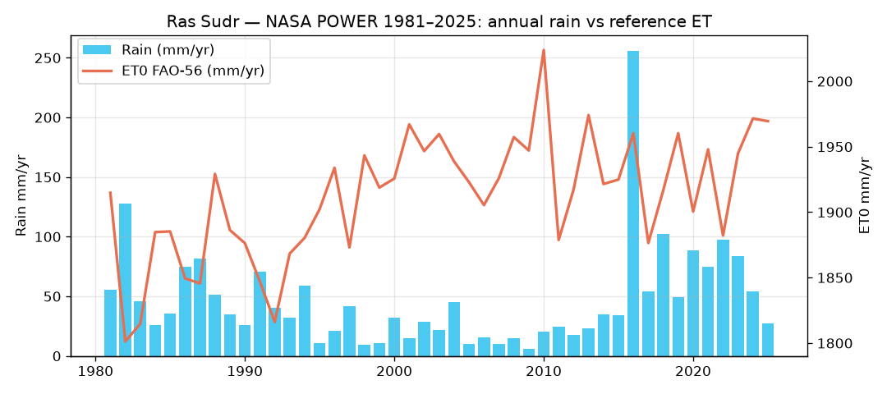

# 01 — Climate (NASA POWER, FAO-56)

Source: NASA POWER daily point API (community AG), pixel 29.5907 N 32.7203 E, elev 215 m. 2020-01→2026-09 from our team file, 1981-2019 fetched from the API. The 2020–2021 overlap between API and file has max abs difference **0.0** for every variable (`data/processed/power_1981_2026.overlap.csv`).

Solar radiation is missing for 1981–1983 in POWER; those days use Hargreaves Rs (FAO-56 Eq.50). Raw Hargreaves (kRs 0.16) is -23.8 % vs CERES on 1984–2025, so it is bias-corrected per calendar month with the CERES/Hargreaves ratio before use (flag `rs_filled`).

**Mean annual ET0 (1981–2025): 1,912 mm** (range 1,801–2,024); expected ≈1,900 → ✅. **Mean rain: 47 mm/yr** (range 6–256).

## Monthly climatology vs S1 Table 1 (1983–2020, Nov–Apr)

| month | Tmin_S1 | Tmin_POWER | Tmax_S1 | Tmax_POWER | P_S1_mm | P_POWER_mm |
|---|---|---|---|---|---|---|
| Nov | 13.4 | 15.2 | 23.9 | 24.1 | 7.4 | 6.8 |
| Dec | 9.4 | 11.5 | 19.0 | 19.6 | 8.1 | 7.7 |
| Jan | 7.6 | 9.5 | 17.4 | 17.9 | 7.7 | 7.2 |
| Feb | 8.0 | 9.9 | 18.9 | 19.3 | 6.7 | 6.1 |
| Mar | 9.9 | 11.5 | 22.4 | 22.3 | 7.2 | 5.6 |
| Apr | 13.1 | 14.4 | 27.0 | 26.5 | 3.7 | 3.3 |

## Five hottest seasons (mean Tmax anomaly vs same season type)

| season_year | season | tmax_mean | tmax_anom | heat_days | rain_mm |
|---|---|---|---|---|---|
| 2009 | W | 23.7 | 2.1 | 0 | 18.2 |
| 2025 | W | 23.0 | 1.3 | 0 | 21.7 |
| 2024 | S | 33.3 | 1.3 | 74 | 2.4 |
| 2023 | W | 22.8 | 1.2 | 2 | 67.1 |
| 2017 | W | 22.8 | 1.1 | 1 | 104.5 |

## Five driest winters (rain Nov–Apr)

| season_year | season | rain_mm | ET0_mm | tmax_mean |
|---|---|---|---|---|
| 2008 | W | 3.8 | 684.9 | 22.5 |
| 1999 | W | 9.8 | 642.8 | 21.4 |
| 1998 | W | 10.4 | 650.7 | 21.9 |
| 1997 | W | 10.8 | 643.5 | 21.6 |
| 2005 | W | 10.9 | 655.2 | 22.2 |

## Annual table

| year | ET0_mm | rain_mm | tmax_mean | tmin_mean | heat_days |
|---|---|---|---|---|---|
| 1981 | 1914.8 | 55.8 | 26.4 | 15.7 | 23 |
| 1982 | 1801.3 | 127.6 | 25.5 | 15.2 | 11 |
| 1983 | 1814.7 | 45.9 | 25.5 | 15.0 | 10 |
| 1984 | 1884.8 | 25.8 | 26.3 | 15.4 | 11 |
| 1985 | 1885.3 | 35.9 | 26.7 | 15.9 | 17 |
| 1986 | 1849.4 | 74.8 | 26.2 | 15.6 | 15 |
| 1987 | 1845.6 | 81.5 | 26.1 | 15.4 | 27 |
| 1988 | 1929.2 | 51.5 | 26.9 | 16.1 | 51 |
| 1989 | 1886.3 | 34.6 | 26.5 | 15.6 | 17 |
| 1990 | 1876.4 | 25.6 | 26.7 | 15.9 | 13 |
| 1991 | 1847.2 | 70.7 | 26.5 | 16.1 | 18 |
| 1992 | 1816.1 | 40.2 | 25.5 | 15.1 | 20 |
| 1993 | 1868.4 | 32.0 | 26.6 | 15.9 | 23 |
| 1994 | 1880.4 | 59.2 | 26.7 | 16.2 | 19 |
| 1995 | 1902.2 | 10.9 | 26.5 | 15.7 | 27 |
| 1996 | 1933.9 | 21.2 | 26.9 | 16.1 | 31 |
| 1997 | 1873.1 | 41.6 | 26.3 | 15.8 | 22 |
| 1998 | 1943.3 | 9.7 | 27.2 | 16.4 | 43 |
| 1999 | 1918.8 | 10.8 | 27.1 | 16.3 | 27 |
| 2000 | 1925.7 | 32.4 | 26.4 | 15.7 | 28 |
| 2001 | 1967.0 | 14.8 | 27.2 | 16.4 | 37 |
| 2002 | 1946.7 | 28.4 | 27.2 | 16.4 | 36 |
| 2003 | 1959.6 | 21.9 | 27.1 | 16.4 | 21 |
| 2004 | 1938.8 | 45.1 | 26.9 | 16.2 | 20 |
| 2005 | 1922.9 | 10.2 | 26.8 | 16.3 | 30 |
| 2006 | 1905.4 | 15.5 | 26.6 | 16.1 | 23 |
| 2007 | 1926.0 | 10.0 | 27.1 | 16.4 | 35 |
| 2008 | 1957.3 | 14.7 | 27.3 | 16.5 | 36 |
| 2009 | 1947.1 | 6.1 | 27.2 | 16.6 | 20 |
| 2010 | 2023.8 | 20.1 | 28.7 | 17.8 | 44 |
| 2011 | 1878.8 | 24.5 | 26.3 | 16.0 | 18 |
| 2012 | 1917.3 | 17.6 | 26.9 | 16.5 | 34 |
| 2013 | 1974.1 | 23.3 | 27.2 | 16.5 | 15 |
| 2014 | 1921.5 | 35.0 | 27.4 | 17.0 | 27 |
| 2015 | 1924.9 | 33.9 | 27.1 | 16.9 | 41 |
| 2016 | 1960.3 | 256.0 | 27.4 | 16.9 | 39 |
| 2017 | 1876.5 | 53.9 | 26.6 | 16.3 | 34 |
| 2018 | 1916.8 | 102.4 | 27.5 | 17.4 | 25 |
| 2019 | 1960.3 | 49.2 | 27.2 | 16.8 | 36 |
| 2020 | 1900.5 | 88.6 | 27.1 | 16.7 | 33 |
| 2021 | 1948.0 | 74.8 | 27.5 | 16.9 | 36 |
| 2022 | 1882.2 | 97.2 | 26.7 | 16.6 | 22 |
| 2023 | 1944.9 | 83.7 | 27.9 | 17.7 | 51 |
| 2024 | 1971.5 | 54.0 | 27.8 | 17.5 | 76 |
| 2025 | 1969.5 | 27.4 | 27.8 | 17.2 | 37 |

Effective rain: USDA-SCS monthly formula (assumptions `clim.peff_*`). Heat days: Tmax > 35 °C (`clim.heat_report_c`).