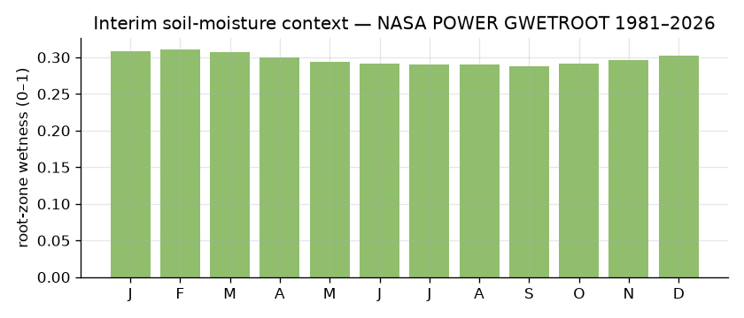

# 02 — NASA Earth observation (Earth Engine)

**Status: PENDING** — Earth Engine not available: run `earthengine authenticate`, set GEE_PROJECT, then `make data`. (EEException: Please authorize access to your Earth Engine account by running)

Code: `engine/dawra/eo.py` (all 9 extractors; batched `reduceRegion` requests; CSV cache in `data/eo/`). AOI: Ras Sudr plain, lon 32.65–32.80, lat 29.50–29.75; point products at the DRC station 29.5997 N 32.7014 E.

| product | dataset | Earth Engine id | used for |
|---|---|---|---|
| NDVI | Sentinel-2 SR harmonized (10 m, 2017+) + Landsat 5/7/8/9 C2 L2 (30 m, 1990+) | COPERNICUS/S2_SR_HARMONIZED; LANDSAT/L*0*/C02/T1_L2 | field history, bare seasons, vegetated area |
| Soil moisture | SMAP L4 surface & root zone (9 km, 2015+) | NASA/SMAP/SPL4SMGP/008 | drought context; coastal pixel mixing caveat |
| Precipitation | GPM IMERG V07 (0.1°, 2000+) | NASA/GPM_L3/IMERG_V07 | heavy-rain days >10/>20 mm |
| LST & ET | MODIS MOD11A2 LST (1 km) + MOD16A2GF ET (500 m) | MODIS/061/MOD11A2; MODIS/061/MOD16A2GF | heat anomalies; ET0 cross-check |
| Terrain | SRTM 1 arc-second (30 m) | USGS/SRTMGL1_003 | slope / elevation of fields |
| Groundwater | GRACE/GRACE-FO JPL/CSR mascons (~1°) | NASA/GRACE/MASS_GRIDS_V04/MASCON_CRI | regional water-storage trend (coarse) |
| Climate futures | NASA NEX-GDDP-CMIP6 (0.25°) | NASA/GDDP-CMIP6 | 2041–2060 vs 1995–2014 deltas, SSP2-4.5 / SSP5-8.5 |

Caveats: SMAP 9 km and IMERG 0.1° pixels mix sea and land at this coastal site; GRACE (~300 km effective) sees the regional aquifer, not one well; CMIP6 0.25° is downscaled but still regional.

## Interim context used while EO is pending

NASA POWER MERRA-2 **GWETROOT** (root-zone soil wetness) is already in our POWER series and is shown in the app and cards as the soil-moisture context.



## To finish

```
earthengine authenticate
set GEE_PROJECT=<your-cloud-project>   # PowerShell: $env:GEE_PROJECT='…'
make data      # or: python tasks.py data
make build     # re-export the web JSON
```

Cached EO files: none yet.