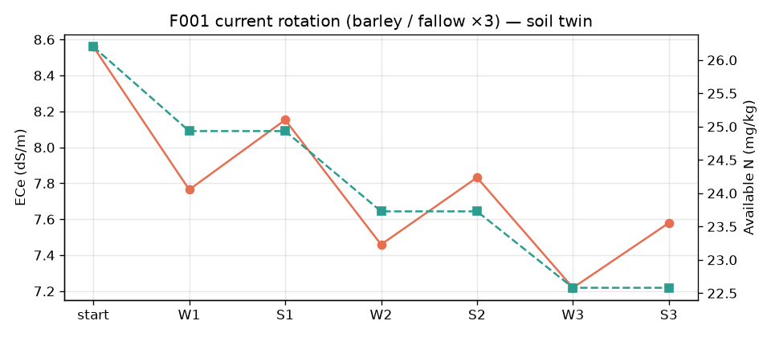

# 03 — Agronomy engine (M2 water & salt · M3 yield · M4 soil twin)

Farm F001: 5 feddan, well ECw 8.35 dS/m, 60 m³/day, drip. Starting soil: ECe 8.56, SOC 0.18 %, N 26.2 mg/kg (Soil_Baseline).

## Current rotation (barley winter / fallow summer ×3), typical climate 1991–2020

| slot | crop | area_fdn | water_mm | water_m3 | rel_yield_% | yield_kg_ha | ECe_end | SOC_% | N_mg_kg |
|---|---|---|---|---|---|---|---|---|---|
| W1 | barley | 2.42 | 501.03 | 5086.58 | 99.93 | 4264.97 | 7.76 | 0.18 | 24.93 |
| S1 | fallow | 0.00 | 0.00 | 0.00 | 0.00 | 0.00 | 8.15 | 0.18 | 24.93 |
| W2 | barley | 2.42 | 501.03 | 5086.58 | 99.93 | 4264.97 | 7.46 | 0.18 | 23.73 |
| S2 | fallow | 0.00 | 0.00 | 0.00 | 0.00 | 0.00 | 7.83 | 0.18 | 23.73 |
| W3 | barley | 2.42 | 501.03 | 5086.58 | 99.93 | 4264.97 | 7.22 | 0.18 | 22.58 |
| S3 | fallow | 0.00 | 0.00 | 0.00 | 0.00 | 0.00 | 7.58 | 0.18 | 22.58 |

Totals: water **15,260 m³** in 3 years, productivity index 1.45, soil health index 52.2 (50 = unchanged).

Planted area is water-limited: the well's m³/day divided by the crop's peak 10-day gross demand (FAO-56 ETc, FAO-29 leaching, drip Ea 0.90). The rest of the farm stays fallow that season.

## Calibration (fitted)

ECe/ECw calibration factor k = **0.703** on the FAO-29 relation ECe/ECw = (1+LF)/(5·LF), so LF 0.15 gives the measured 8.56 at ECw 7.94 (S4).

| crop | observed_kg_ha | modelled_rel_yield_% | ECe_mean | ymax_kg_ha | source |
|---|---|---|---|---|---|
| barley | 4215.00 | 98.76 | 8.25 | 4267.82 | S1 (Local_Yields) |
| barley_forage | 15456.00 | 91.33 | 7.21 | 16923.04 | S1 (Local_Yields) |

Barley uses the S1 trial's own water (≈400 mm furrow, Local_Yields) and seasons 2018/19–2019/20.

## Checks (not fitted)

| check | modelled | observed | unit | error_% | source |
|---|---|---|---|---|---|
| ECe at ECw 7.94, LF 0.15 | 8.6 | 8.6 | dS/m | 0.0 | S4 |
| wheat holdout (t/feddan reading) | 5000.0 | 5904.8 | kg/ha | -15.3 | S6 |
| wheat holdout (t/ha reading) | 5000.0 | 2480.0 | kg/ha | 101.6 | S6 |
| barley seasonal gross requirement (furrow, with LR) | 693.3 | 400.0 | mm | 73.3 | S1 |

*Wheat holdout*: S6 reports 16.5 ardeb (~2.48 t) and the sheet notes the area unit is not stated. Read per feddan (5.9 t/ha) the error is within ±20 %; read per hectare it is not. Both are shown.

*S1 water*: the FAO-29 gross requirement (with leaching and furrow losses) is higher than the ~400 mm the trial applied — the trial ran with less leaching than FAO-29 recommends. Dawra plans use the FAO-29 requirement (conservative for water).

## Assumptions used by M2–M4

| id | value | unit | justification | source |
|---|---|---|---|---|
| ws.frac_ini | 0.15 | - | default when Crops.stage_days_source has no 4-number split (Prompt 3) | FAO-56 (Allen et al. 1998) Table 11 typical |
| ws.frac_dev | 0.25 | - | as above | FAO-56 (Allen et al. 1998) Table 11 typical |
| ws.frac_mid | 0.4 | - | as above | FAO-56 (Allen et al. 1998) Table 11 typical |
| ws.frac_late | 0.2 | - | as above | FAO-56 (Allen et al. 1998) Table 11 typical |
| ws.ea_drip | 0.9 | - | Prompt 3 spec | FAO-56 (Allen et al. 1998) |
| ws.ea_sprinkler | 0.75 | - | Prompt 3 spec | FAO-56 (Allen et al. 1998) |
| ws.ea_furrow | 0.6 | - | Prompt 3 spec; S1 trial used furrow | FAO-56 (Allen et al. 1998) |
| ws.lr_cap | 0.5 | - | cap from Prompt 3; above this the crop is not viable | FAO-29 (Ayers & Westcot 1985) |
| ws.peak_window_days | 10 | days | peak = max 10-day mean gross demand (design practice) | assumption |
| ws.kc_ini.bermuda | 0.55 | - | Bermuda hay, averaged cutting effects | FAO-56 (Allen et al. 1998) Table 12 |
| ws.kc_mid.bermuda | 1.0 | - | Bermuda hay, averaged cutting effects | FAO-56 (Allen et al. 1998) Table 12 |
| ws.kc_end.bermuda | 0.85 | - | Bermuda hay, averaged cutting effects | FAO-56 (Allen et al. 1998) Table 12 |
| ws.kc_ini.rhodes | 0.55 | - | not in FAO-56; set equal to Bermuda hay (similar warm-season perennial grass) | FAO-56 (Allen et al. 1998) Table 12 (proxy) |
| ws.kc_mid.rhodes | 1.0 | - | proxy = Bermuda | FAO-56 (Allen et al. 1998) Table 12 (proxy) |
| ws.kc_end.rhodes | 0.85 | - | proxy = Bermuda | FAO-56 (Allen et al. 1998) Table 12 (proxy) |
| ws.kc_ini.quinoa | 0.52 | - | not in FAO-56; field-measured values | Garcia et al. 2003 Agric. Water Manag. 60:119 |
| ws.kc_mid.quinoa | 1.0 | - | as above | Garcia et al. 2003 |
| ws.kc_end.quinoa | 0.7 | - | as above | Garcia et al. 2003 |
| ws.kc_ini.sesbania | 0.4 | - | not in FAO-56; proxy = cowpea row of Crops sheet (summer legume) | Crops sheet cowpea proxy |
| ws.kc_mid.sesbania | 1.05 | - | proxy = cowpea | Crops sheet cowpea proxy |
| ws.kc_end.sesbania | 0.48 | - | proxy = cowpea | Crops sheet cowpea proxy |
| ws.root.bermuda | 1.25 | m | Bermuda for hay 1.0-1.5 m (mean) | FAO-56 (Allen et al. 1998) Table 22 |
| ws.root.rhodes | 1.25 | m | proxy = Bermuda | FAO-56 (Allen et al. 1998) Table 22 (proxy) |
| ws.root.quinoa | 1.0 | m | typical 0.8-1.2 m; no local data | assumption |
| ws.root.sesbania | 1.0 | m | between cowpea (0.8) and alfalfa (1.5) | assumption |
| ws.fallow_zone_m | 1.0 | m | Soil_Baseline TAW is given per metre | Soil_Baseline |
| sow.barley | -7 | days | 25 Oct early sowing (S1 best date) | S1 |
| sow.wheat | 14 | days | Crops window Nov-Dec (mid-Nov) | Crops sheet |
| sow.triticale | 14 | days | Crops window Nov-Dec | Crops sheet |
| sow.barley_forage | 0 | days | Crops window Oct-Nov | Crops sheet |
| sow.sugar_beet | -17 | days | window Sep-Nov; 15 Oct so 205 d ends before summer sowing | Crops sheet |
| sow.quinoa | 14 | days | Crops window Nov | Crops sheet |
| sow.faba_bean | -7 | days | Crops window Oct-Nov | Crops sheet |
| sow.tomato | 0 | days | Crops window Oct/Nov | Crops sheet |
| sow.squash | 30 | days | Crops window Dec | Crops sheet |
| sow.alfalfa | 0 | days | Crops window Oct-Nov | Crops sheet |
| sow.sorghum | 14 | days | Crops window Apr-Jun | Crops sheet |
| sow.pearl_millet | 14 | days | Crops window Apr-Jun | Crops sheet |
| sow.sudan_grass | 0 | days | Crops window Apr-Jun | Crops sheet |
| sow.cotton | 0 | days | Crops window Mar-May (latest date, after the winter crop) | Crops sheet |
| sow.cowpea | 14 | days | Crops window Mar-Jun | Crops sheet |
| sow.sesbania | 14 | days | Crops window Apr-Jun | Crops sheet |
| sow.watermelon | 0 | days | Crops window Mar-May | Crops sheet |
| sow.bermuda | 0 | days | Crops window Mar-May | Crops sheet |
| sow.rhodes | 0 | days | Crops window Mar-May | Crops sheet |
| cal.max_overlap_days | 7 | days | short relay overlap tolerated | assumption |
| yield.rating.quinoa | T | class | no FAO-29 entry (README note 5); grown at ECw 7.94 / ECe 8.56 in S4 | S4 |
| yield.rating.pearl_millet | MT | class | no FAO-29 entry; conservative moderately-tolerant class | assumption |
| yield.rating_method | median_of_rating_class | - | crops without FAO-29 numbers get the median ECe_100 / ECe_50 of Crops-sheet crops with the same salt_rating | FAO-29 Table 4/5 via Crops sheet |
| heat.tcrit.winter_cereal | 32 | degC | wheat/barley anthesis-grain fill damage above ~31-32 degC | Porter & Gawith 1999 Eur. J. Agron. 10:23 |
| heat.tcrit.c4_grass | 40 | degC | sorghum/millet pollen viability falls above ~38-40 degC | Prasad et al. 2008 Crop Sci. 48:1911 |
| heat.tcrit.cotton | 38 | degC | boll retention drops above ~36-38 degC | Reddy et al. 1991 |
| heat.tcrit.legume | 36 | degC | cowpea flower abortion with hot days | Hall 2004 Eur. J. Agron. 21:447 |
| heat.tcrit.cool_legume | 30 | degC | cool-season legume | assumption (literature range 28-32) |
| heat.tcrit.vegetable | 35 | degC | fruit set failure | assumption (literature range 32-35) |
| heat.tcrit.root_pseudo | 32 | degC | quinoa anthesis sensitive above ~32 degC | Hinojosa et al. 2018 |
| heat.tcrit.perennial | 40 | degC | warm-season perennials | assumption |
| heat.penalty_per_day | 0.01 | fraction/day | linear damage function; 1 % per day | assumption |
| heat.max_penalty | 0.5 | fraction | cap | assumption |
| ymax.wheat | 5000 | kg/ha | irrigated good commercial 4-6 t/ha (midpoint); independent of the S6 holdout | FAO-33 (Doorenbos & Kassam 1979) |
| ymax.triticale | 5000 | kg/ha | no FAO-33 entry; set equal to wheat | assumption |
| ymax.sorghum | 4250 | kg/ha | 3.5-5 t/ha midpoint | FAO-33 (Doorenbos & Kassam 1979) |
| ymax.pearl_millet | 3000 | kg/ha | arid-zone irrigated typical | assumption |
| ymax.sudan_grass | 10000 | kg/ha | multi-cut summer hay | assumption |
| ymax.bermuda | 7500 | kg/ha | 15 t DM/yr split over two seasons | assumption |
| ymax.rhodes | 7500 | kg/ha | proxy = Bermuda | assumption |
| ymax.sugar_beet | 50000 | kg/ha | 40-60 t/ha midpoint | FAO-33 (Doorenbos & Kassam 1979) |
| ymax.quinoa | 2500 | kg/ha | irrigated 2-3 t/ha; no local numeric yield in Local_Yields | assumption |
| ymax.cotton | 4500 | kg/ha | 4-5 t/ha midpoint | FAO-33 (Doorenbos & Kassam 1979) |
| ymax.alfalfa | 7500 | kg/ha | 15 t DM/yr (range 8-22) split over two seasons | FAO-33 (Doorenbos & Kassam 1979) |
| ymax.cowpea | 2000 | kg/ha | 1.5-2.5 t/ha (dry bean class) midpoint | FAO-33 (Doorenbos & Kassam 1979) |
| ymax.faba_bean | 2500 | kg/ha | 2-3 t/ha midpoint | FAO-33 (Doorenbos & Kassam 1979) |
| ymax.sesbania | 6000 | kg/ha | DM incorporated, not sold | assumption |
| ymax.tomato | 55000 | kg/ha | 45-65 t/ha midpoint | FAO-33 (Doorenbos & Kassam 1979) |
| ymax.squash | 20000 | kg/ha | no FAO-33 entry | assumption |
| ymax.watermelon | 30000 | kg/ha | 25-35 t/ha midpoint | FAO-33 (Doorenbos & Kassam 1979) |
| soil.lf_cal | 0.15 | - | Soil_Baseline leaching_fraction, used to calibrate ECe/ECw = 8.56/7.94 (S4) | Soil_Baseline; S4 |
| soil.fallow_ece_rise | 0.05 | fraction | evaporative concentration in topsoil; no local measurement - high uncertainty (sensitivity tested) | assumption |
| soil.bulk_density | 1.5 | g/cm3 | typical loamy sand | assumption (Saxton & Rawls 2006 range 1.45-1.6) |
| soil.pool_depth | 0.3 | m | matches SoilGrids 0-30 cm layer | S18 |
| soil.soc_decay_crop | 0.02 | fraction | ~4 %/yr for warm irrigated sandy soils | assumption (ICBM-type first order) |
| soil.soc_decay_fallow | 0.005 | fraction | decomposition limited by dryness | assumption |
| soil.humification | 0.125 | - | straw humification coefficient | Andren & Katterer 1997 (ICBM) |
| soil.resC.cereal | 1.2 | t C/ha | roots + stubble at full yield (straw grazed/removed) | assumption (Bolinder et al. 2007 root:shoot) |
| soil.resC.forage | 0.6 | t C/ha | roots/stubble only | assumption |
| soil.resC.legume | 0.8 | t C/ha | roots + nodules + stubble | assumption |
| soil.resC.green_manure | 2.5 | t C/ha | whole biomass incorporated | assumption |
| soil.resC.cash | 0.8 | t C/ha | cotton stalks / beet tops partly returned | assumption |
| soil.resC.vegetable | 0.4 | t C/ha | little residue (Crops soil_role: high input; little residue) | Crops sheet soil_role |
| soil.resC.perennial | 1.0 | t C/ha | permanent roots, no tillage | assumption |
| soil.n_loss_crop | 0.1 | fraction | leaching under high LF in sand (net of fertiliser) | assumption |
| soil.nfix.cowpea | 40 | kg N/ha | net N benefit to following crop | assumption (Peoples et al. 2009 range) |
| soil.nfix.faba_bean | 40 | kg N/ha | net N benefit to following crop | assumption (Peoples et al. 2009 range) |
| soil.nfix.alfalfa | 60 | kg N/ha | net N benefit | assumption (Peoples et al. 2009 range) |
| soil.nfix.sesbania | 80 | kg N/ha | incorporated green manure | assumption (Ladha et al. 1992 range) |
| si.w_ece | 0.5 | - | salinity is the main constraint (README note 1) | assumption |
| si.w_soc | 0.3 | - | organic matter is very low (0.18 %) | assumption |
| si.w_n | 0.2 | - | N is low (26.2 mg/kg) | assumption |
| si.scale | 0.5 | fraction | +-50 % change = 0 or 100 | assumption |
| si.pest_penalty | 5 | points | 3rd consecutive same-family season | assumption |
| conv.tds_per_ec | 640 | mg/L per dS/m | ppm to dS/m conversion used in Soil_Water_Measured | FAO-29 (Soil_Water_Measured note) |
| cal.s6_system | furrow | - | S6 does not state the method; DRC station trials used furrow (S1) | assumption |
| cal.s1_system | furrow | - | weekly furrow irrigation ~400 mm/season | S1 / Local_Yields |
| yield.ky | 1.0 | - | FAO-33 seasonal Ky is 0.85-1.25 for the field crops here; 1.0 used for all | FAO-33 (Doorenbos & Kassam 1979) |
| cal.s6_unit_per_feddan | 1 | flag | Vetogate 2026-04-30 on the same KSIU trial: 16.5 ardeb per feddan (~2.48 t) | https://www.vetogate.com/5646058 |
