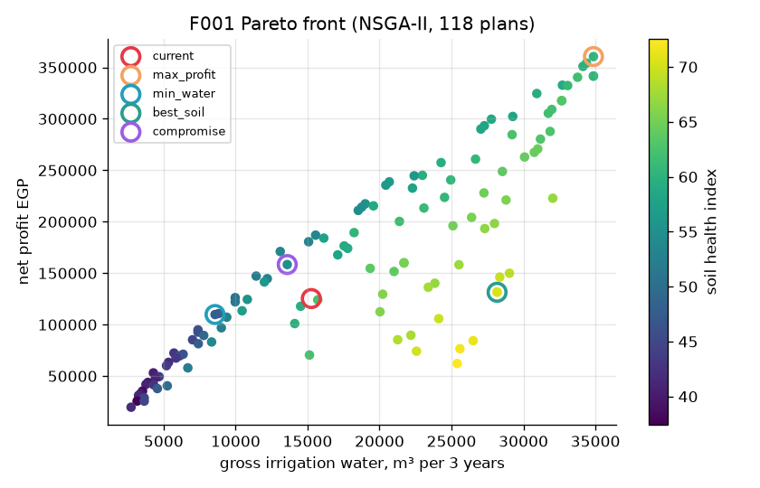

# 05 — Optimiser (M6, NSGA-II)

Farm F001 at ECw 8.35 dS/m, 60 m³/day; population 120 × 200 generations, seed 42. Feasible Pareto plans: **118**; unique plans evaluated: 19,973.

Profit uses data/prices_egp.csv.

## Current rotation vs the four picks (balanced profile for the compromise)

| plan | W1 | S1 | W2 | S2 | W3 | S3 | value | water_m3 | soil_index | min_RY_% | market |
|---|---|---|---|---|---|---|---|---|---|---|---|
| current | barley | fallow | barley | fallow | barley | fallow | 125324.88 | 15259.75 | 52.23 | 99.93 | 1.00 |
| max_profit | wheat | cotton | wheat | cotton | wheat | cotton | 360515.13 | 34862.88 | 60.27 | 97.69 | 0.00 |
| min_water | wheat | fallow | wheat | fallow | wheat | fallow | 109807.90 | 8572.03 | 47.61 | 97.60 | 0.00 |
| best_soil | faba_bean | cotton | squash | sesbania | squash | sesbania | 131447.50 | 28167.75 | 70.55 | 72.63 | 0.33 |
| compromise | wheat | fallow | wheat | fallow | triticale | fallow | 158384.86 | 13587.66 | 54.62 | 97.69 | 0.33 |

Picks: *max_profit* = highest value on the front; *min_water* and *best_soil* = lowest water / highest soil index among plans keeping ≥ 80 % of the current rotation's value (`opt.guard_productivity`); *compromise* = TOPSIS with the profile weights (Farmer_Priorities). Climate-risk weight uses robustness from M7 in the final build.
