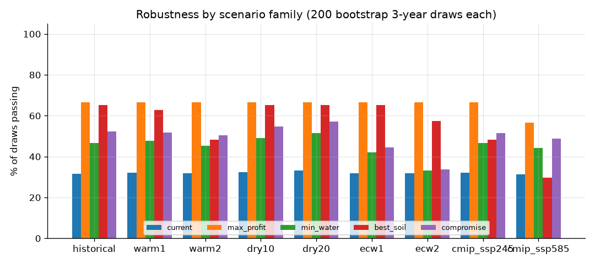

# 06 — Stress test & explanation cards (M7)

Scenario families: historical block bootstrap (agricultural years W(y)+S(y+1), 1981–2025, 3 blocks drawn with replacement, n = 200, seed 7), +1/+2 °C (ET0 recomputed), −10/−20 % rain, well ECw +1/+2 dS/m (aquifer 'highly saline' share 52 % → 83 %, S16). CMIP6 deltas: **pending** (needs Earth Engine).

Pass = every cropped season ≥ 70 % of its typical-climate yield AND final ECe ≤ starting ECe. In each scenario the planted area is fixed beforehand from the typical climate and the well's m³/day cap applies during the peak period, so hotter years and saltier water first cut leaching, then crop water (FAO-33 Ky).

| plan | robustness_% | historical | warm1 | warm2 | dry10 | dry20 | ecw1 | ecw2 | cmip_ssp245 | cmip_ssp585 | worst_cause |
|---|---|---|---|---|---|---|---|---|---|---|---|
| current | 32.0 | 31.7 | 32.0 | 31.8 | 32.5 | 33.2 | 31.8 | 31.8 | 32.0 | 31.3 | salt_buildup |
| max_profit | 65.6 | 66.7 | 66.7 | 66.7 | 66.7 | 66.7 | 66.7 | 66.7 | 66.7 | 56.7 | salt_buildup |
| min_water | 45.2 | 46.7 | 47.7 | 45.3 | 49.0 | 51.5 | 42.0 | 33.3 | 46.7 | 44.3 | salt_buildup |
| best_soil | 56.4 | 65.2 | 62.7 | 48.3 | 65.2 | 65.2 | 65.2 | 57.3 | 48.3 | 29.8 | low_yield |
| compromise | 49.4 | 52.3 | 51.7 | 50.3 | 54.8 | 57.2 | 44.5 | 33.7 | 51.5 | 48.7 | salt_buildup |

**Reading.** Robustness is high for most plans: in this hyper-arid site rain is a tiny share of the water balance (so −20 % rain barely matters), and when the full FAO-29 leaching water is applied the yield stays near potential. The price of heat and salinity is paid in *water per feddan* (fewer feddan the well can irrigate), which the optimiser already counts. The plans that fail most often do so through salt build-up after unirrigated summer fallows.

## Example card — balanced compromise (English)

**why**
- Best overall score (TOPSIS) for your priorities 'balanced': profit 25%, water saving 25%, salt tolerance 20%.
- Sequence: wheat → fallow → wheat → fallow → triticale → fallow. Every crop keeps ≥ 98% of its potential yield at your well's 8.35 dS/m when the leaching water is applied.

**evidence**
- NASA POWER 1981–2025 (CERES radiation; MERRA-2 temperature, humidity, wind, rain) at the DRC Ras Sudr pixel: FAO-56 reference ET 1,912 mm/yr vs only 47 mm/yr of rain.
- Summer days above 35 °C: 28 per year on average (POWER T2M_MAX); MERRA-2 root-zone wetness (GWETROOT) in summer ≈ 0.29 — the soil is dry without irrigation.
- Stress test on 5,400 simulated 3-year futures (45 years of NASA climate, +1/+2 °C, −10/−20% rain, saltier well and CMIP6 2050s futures, and 100/70/40 % of the leaching water): this plan held up in 49% of them.
- Satellite layers (Sentinel-2/Landsat NDVI, SMAP, GPM IMERG, MODIS, SRTM, GRACE, CMIP6) are coded and will be added once Earth Engine access is enabled.
- Yields calibrated on the DRC Ras Sudr barley trial (S1: 4,215 kg/ha at ECw 8.35); soil salinity on S4 (ECe 8.56 at ECw 7.94).

**benefits**
- Net profit 158,385 EGP in 3 years (+26% vs your current 125,325 EGP); ≈ 10,559 EGP per feddan per year.
- Earns more per drop: 11.7 EGP per m³ vs 8.2 now; 0.70 kg of product per m³.
- Saves 11% water (13,588 vs 15,260 m³ in 3 years).
- Leaves less salt in the root zone: ECe 7.3 vs 7.6 dS/m after 3 years.
- Builds soil nitrogen (legumes): 24 vs 23 mg/kg.
- Soil score 55/100 vs 52.

**gaps**
- Prices/costs are estimates (no 2025-26 Egyptian quote found) for: triticale — see data/prices_egp.csv.
- Parameters partly assumed (see data/assumptions.csv) for: triticale (salt thresholds from rating fallback).
- Attainable yield is an assumption (no local trial) for: triticale.
- How fast salt rises in an unirrigated summer fallow is not measured locally (assumed +5% per season).
- Satellite field history (NDVI) for your exact field is pending; the plan uses station-level data.

**risks**
- Measure THIS well's salinity (ECw) every season — Ras Sudr wells range from 3 to 38 dS/m and the 'highly saline' share of the aquifer rose from 52% (1996) to 83% (2022).
- Wheat (bread) (W1, W2) needs 39% extra water for leaching; without it the yield could fall to about 53% (FAO-29 at LF 15%).
- Triticale (W3) needs 44% extra water for leaching; without it the yield could fall to about 42% (FAO-29 at LF 15%).
- If you apply only 70 % / 40 % of the leaching water the plan passes 48% / 0% of futures (salt builds up in 52% / 100%). The S1 trial applied about 60 % of the FAO-29 amount.
- Weakest case: Past climate 1981–2025 — passes 0% of the time; main cause: salt builds up in the soil.
- Decision support only — confirm with your local agricultural extension officer.

## نفس الكارت بالعربي

**why**
- أعلى درجة إجمالية (TOPSIS) حسب أولوياتك 'متوازن': الربح 25٪، توفير المية 25٪، تحمل الملوحة 20٪.
- الترتيب: قمح ← بور (راحة) ← قمح ← بور (راحة) ← تريتيكال ← بور (راحة). كل محصول بيحافظ على 98٪ على الأقل من إنتاجه الممكن مع ملوحة البير 8.35 dS/m لو اتعملت مية الغسيل.

**evidence**
- بيانات ناسا POWER من 1981 لـ 2025 (إشعاع CERES؛ حرارة ورطوبة ورياح ومطر MERRA-2) عند محطة رأس سدر: البخر-نتح المرجعي FAO-56 حوالي 1,912 مم/سنة والمطر 47 مم/سنة بس.
- أيام الصيف اللي فوق 35° حوالي 28 يوم في السنة (POWER T2M_MAX)؛ رطوبة منطقة الجذور (GWETROOT) في الصيف ≈ 0.29 — الأرض ناشفة من غير ري.
- اختبار تحمّل على 5,400 سيناريو لـ 3 سنين (45 سنة مناخ ناسا، +1/+2 درجة، مطر أقل 10/20٪، بير أملح ومستقبل الخمسينات من CMIP6، و100/70/40٪ من مية الغسيل): الخطة نجحت في 49٪ منهم.
- طبقات الأقمار الصناعية (NDVI من Sentinel-2/Landsat، SMAP، IMERG، MODIS، SRTM، GRACE، CMIP6) جاهزة في الكود وهتتضاف أول ما يتفعل Earth Engine.
- الإنتاجية متظبطة على تجربة الشعير في محطة رأس سدر (S1: 4215 كجم/هكتار بملوحة مية 8.35)؛ وملوحة التربة على S4 (ECe 8.56 مع مية 7.94).

**benefits**
- صافي الربح 158,385 جنيه في 3 سنين (+26% مقارنة بـ 125,325 جنيه دلوقتي)؛ حوالي 10,559 جنيه للفدان في السنة.
- بيكسب أكتر من كل نقطة مية: 11.7 جنيه للمتر المكعب مقابل 8.2 دلوقتي؛ و0.70 كجم محصول لكل م³.
- بيوفر 11٪ مية (13,588 مقابل 15,260 م³ في 3 سنين).
- بيسيب ملح أقل في منطقة الجذور: ECe 7.3 مقابل 7.6 dS/m بعد 3 سنين.
- بيزوّد نيتروجين التربة (البقوليات): 24 مقابل 23 مجم/كجم.
- درجة التربة 55/100 مقابل 52.

**gaps**
- الأسعار أو التكاليف تقديرية (ملقيناش سعر مصري 2025-26) لـ: تريتيكال.
- بعض المعاملات مفترضة (شوف data/assumptions.csv) لـ: تريتيكال.
- الإنتاج الممكن مفترض (مفيش تجربة محلية) لـ: تريتيكال.
- سرعة زيادة الملح في البور الصيفي مش متقاسة محليًا (مفترضة +5٪ كل موسم).
- تاريخ الحقل بالأقمار الصناعية (NDVI) لأرضك بالظبط لسه؛ الخطة مبنية على بيانات المحطة.

**risks**
- قيس ملوحة البير بتاعك (ECw) كل موسم — آبار رأس سدر من 3 لـ 38 dS/m، ونسبة المية 'عالية الملوحة' زادت من 52٪ (1996) لـ 83٪ (2022).
- قمح (W1, W2) محتاج 39٪ مية زيادة لغسيل الملح؛ من غيرها الإنتاج ممكن ينزل لحوالي 53٪ (FAO-29 عند LF 15٪).
- تريتيكال (W3) محتاج 44٪ مية زيادة لغسيل الملح؛ من غيرها الإنتاج ممكن ينزل لحوالي 42٪ (FAO-29 عند LF 15٪).
- لو حطيت 70٪ / 40٪ بس من مية الغسيل الخطة بتنجح في 48٪ / 0٪ من الحالات (الملح بيتراكم في 52٪ / 100٪). تجربة S1 حطت حوالي 60٪ من كمية FAO-29.
- أضعف حالة: مناخ الماضي 1981–2025 — بتنجح 0٪ من المرات؛ السبب الأساسي: الملح بيتراكم في التربة.
- ده دعم للقرار بس — راجع المرشد الزراعي في منطقتك قبل التنفيذ.
