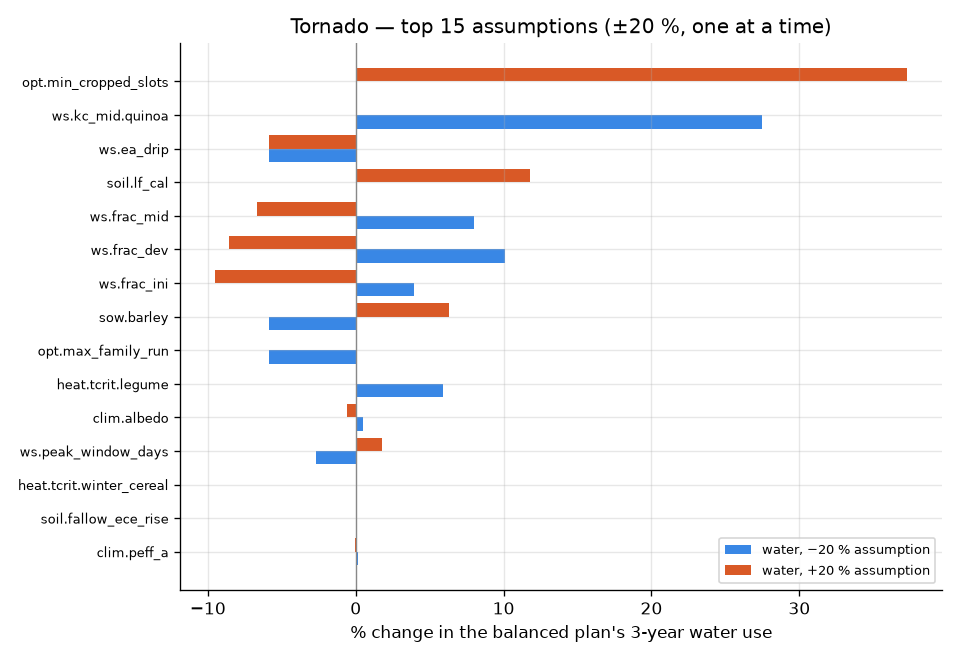

# 08 — Sensitivity (±20 % on each assumption)

99 numeric assumptions from `data/assumptions.csv` were varied by −20 % and +20 %, one at a time (198 engine rebuilds incl. calibration). Candidate plans = the baseline NSGA-II front for F001 (ECw 8.35, 60 m³/day) + the current rotation; picks recomputed each time (balanced weights, risk weight set to 0 because robustness is not re-run per perturbation). Run-control values (population, seeds, bootstrap size, stress-only thresholds) are excluded.

**Assumptions that change at least one pick: 19 of 99.**

| id | base_value | picks_changed | comp_value_-20% | comp_value_+20% | comp_water_-20% | comp_water_+20% |
|---|---|---|---|---|---|---|
| opt.min_cropped_slots | 3 | compromise, min_water | +0.0 | +14.5 | +0.0 | +37.3 |
| ws.kc_mid.quinoa | 1 | compromise, max_profit | +17.4 | +0.0 | +27.5 | +0.0 |
| ws.ea_drip | 0.9 | best_soil, compromise, min_water | -19.4 | +9.0 | -5.9 | -5.9 |
| soil.lf_cal | 0.15 | best_soil, compromise, min_water | +1.5 | +4.4 | +0.0 | +11.8 |
| ws.frac_mid | 0.4 | best_soil, compromise, max_profit, min_water | +10.8 | -8.4 | +8.0 | -6.7 |
| ws.frac_dev | 0.25 | best_soil, compromise, min_water | +7.6 | -6.1 | +10.1 | -8.6 |
| ws.frac_ini | 0.15 | compromise, min_water | +2.8 | -5.1 | +3.9 | -9.5 |
| sow.barley | -7 | best_soil, compromise, min_water | -2.4 | +2.9 | -5.9 | +6.3 |
| opt.max_family_run | 2 | best_soil, compromise, max_profit | -2.4 | +0.0 | -5.9 | +0.0 |
| heat.tcrit.legume | 36 | compromise | +2.2 | +0.0 | +5.9 | +0.0 |
| clim.albedo | 0.23 | min_water | -4.1 | +4.5 | +0.5 | -0.6 |
| ws.peak_window_days | 10 | min_water | -2.9 | +1.9 | -2.7 | +1.8 |
| heat.tcrit.winter_cereal | 32 | min_water | -0.6 | +0.0 | +0.0 | +0.0 |
| soil.fallow_ece_rise | 0.05 | min_water | +0.5 | -0.5 | +0.0 | +0.0 |
| ws.lr_cap | 0.5 | best_soil, min_water | +0.0 | +0.0 | +0.0 | +0.0 |
| heat.tcrit.c4_grass | 40 | best_soil, max_profit | +0.0 | +0.0 | +0.0 | +0.0 |
| sow.squash | 30 | min_water | +0.0 | +0.0 | +0.0 | +0.0 |
| heat.tcrit.vegetable | 35 | min_water | +0.0 | +0.0 | +0.0 | +0.0 |
| opt.guard_productivity | 0.8 | best_soil, min_water | +0.0 | +0.0 | +0.0 | +0.0 |

## Top 15 by swing

| id | base_value | comp_value_-20% | comp_value_+20% | comp_water_-20% | comp_water_+20% | picks_changed |
|---|---|---|---|---|---|---|
| opt.min_cropped_slots | 3 | +0.0 | +14.5 | +0.0 | +37.3 | compromise, min_water |
| ws.kc_mid.quinoa | 1 | +17.4 | +0.0 | +27.5 | +0.0 | compromise, max_profit |
| ws.ea_drip | 0.9 | -19.4 | +9.0 | -5.9 | -5.9 | best_soil, compromise, min_water |
| soil.lf_cal | 0.15 | +1.5 | +4.4 | +0.0 | +11.8 | best_soil, compromise, min_water |
| ws.frac_mid | 0.4 | +10.8 | -8.4 | +8.0 | -6.7 | best_soil, compromise, max_profit, min_water |
| ws.frac_dev | 0.25 | +7.6 | -6.1 | +10.1 | -8.6 | best_soil, compromise, min_water |
| ws.frac_ini | 0.15 | +2.8 | -5.1 | +3.9 | -9.5 | compromise, min_water |
| sow.barley | -7 | -2.4 | +2.9 | -5.9 | +6.3 | best_soil, compromise, min_water |
| opt.max_family_run | 2 | -2.4 | +0.0 | -5.9 | +0.0 | best_soil, compromise, max_profit |
| heat.tcrit.legume | 36 | +2.2 | +0.0 | +5.9 | +0.0 | compromise |
| clim.albedo | 0.23 | -4.1 | +4.5 | +0.5 | -0.6 | min_water |
| ws.peak_window_days | 10 | -2.9 | +1.9 | -2.7 | +1.8 | min_water |
| heat.tcrit.winter_cereal | 32 | -0.6 | +0.0 | +0.0 | +0.0 | min_water |
| soil.fallow_ece_rise | 0.05 | +0.5 | -0.5 | +0.0 | +0.0 | min_water |
| clim.peff_a | 125 | +0.0 | -0.0 | +0.1 | -0.1 |  |

Reading: the plan ranking is most sensitive to the FAO-56 stage-length fractions and drip efficiency (they set peak demand, hence how many feddan the well can water), to quinoa's Kc (quinoa is a FAO-56 gap), to the S4-based ECe calibration (`soil.lf_cal`) and to the planning rule 'at least 3 cropped seasons'. Prices, once available, will add another first-order driver. Picks are robust to the residue-carbon, nitrogen, effective-rain and most heat thresholds.

Full table: `data/processed/sensitivity.csv`.